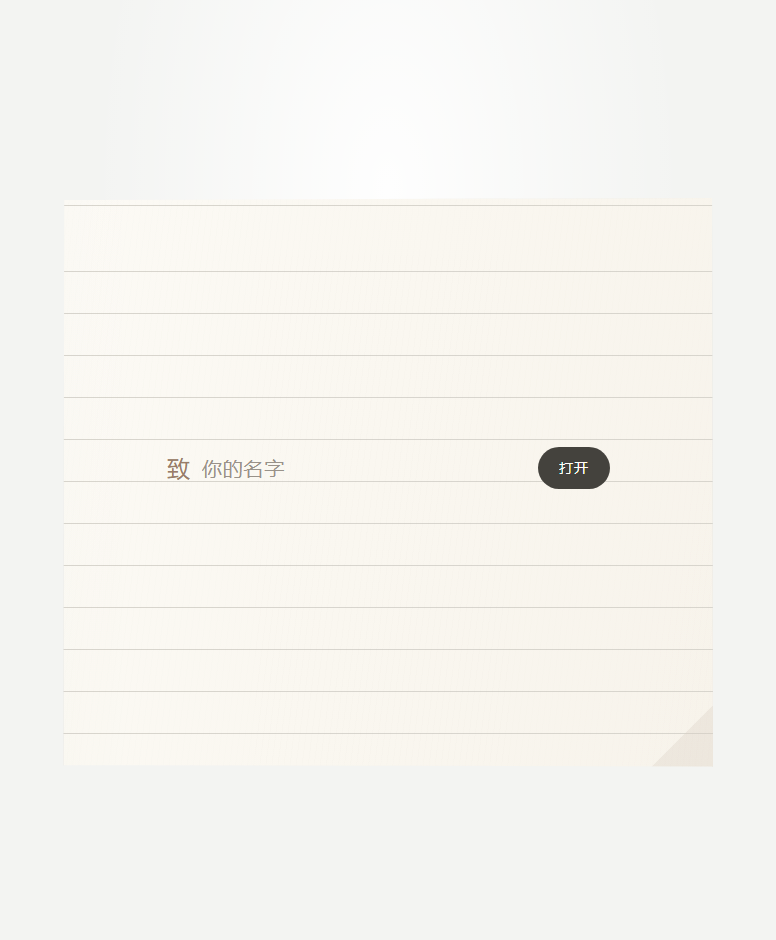
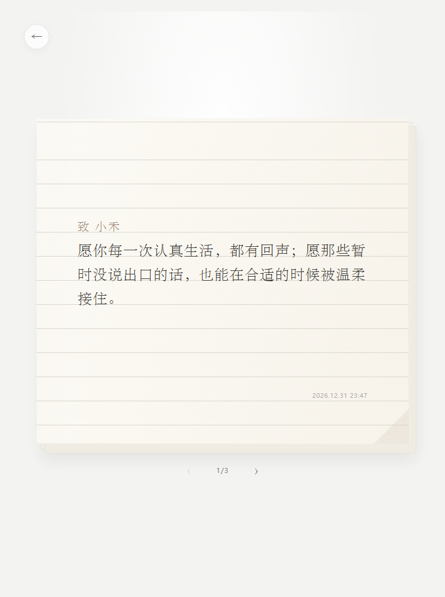
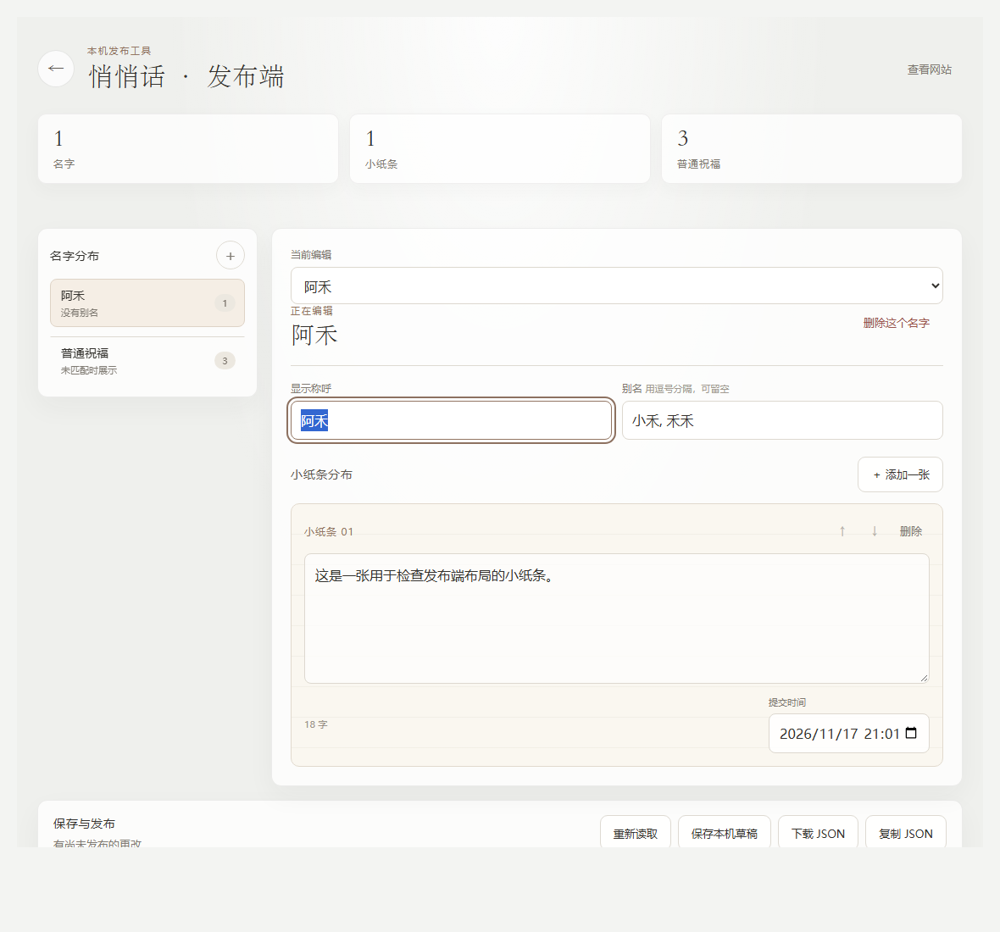

# 跨年悄悄话 · Whispers

> 一张米白横线纸，写一句只对某个人说的话。



## 项目简介

「跨年悄悄话」是一个面向家人与朋友的轻量私人寄语网站。访客输入名字后，只会打开属于自己的纸条；一个人的话可以有多张，通过前后翻页逐张阅读。没有匹配到名字时，页面会展示一组普通祝福，不出现“查无此人”的尴尬结果。

项目采用纯前端静态架构：内容保存在 `notes.json`，页面部署在 GitHub Pages 等静态平台。发布端支持按姓名组织多张纸条，并可通过 GitHub API 直接提交更新，无需数据库或自建服务器。

## 设计目标

- **留白优先**：只保留一张纸、一组称呼或一段文字，减少与内容无关的视觉噪音。
- **仪式感但不厚重**：横向纸张纹理、纸页层次、轻折角和克制的页间过渡共同建立“打开一封信”的感觉。
- **避免尴尬**：未匹配姓名直接进入普通祝福，不暴露检索失败。
- **姓名与多纸条分离**：同一个人可以拥有多张独立纸条，每张纸条带自己的提交时间。
- **公开数据的边界透明**：页面不承诺不具备条件实现的强隐私，只适合低敏感的私人内容。
- **发布流程可维护**：数据与程序分离，手机上也能修改内容并提交。

## 交互流程

```text
输入名字
   ├─ 匹配到姓名/别名 → 打开该名字下的多张纸条 → 使用 1/N 翻页
   └─ 没有匹配         → 展示普通祝福
```

- 纸条内容与横线使用相同的 42px 垂直节奏，正文基线落在横线上。
- 翻页支持按钮与键盘左右方向键。
- 返回键回到名字输入页，不限制同一设备查询次数。
- 页面在 320px 手机宽度至桌面宽度下保持单列纸面布局。



## 功能

### 访客端

- 姓名与别名精确匹配
- 重名时可设置小问题和答案，确认身份后再打开纸条
- 一人多纸条，按 `1/3` 形式显示当前页与总页数
- 每张纸条显示独立称呼与提交时间
- 未匹配姓名直接展示普通祝福
- 返回、上一页、下一页及键盘操作
- 加载失败提示、空输入反馈和响应式布局

### 发布端

- 按姓名查看名字分布和纸条数量
- 添加、修改和删除姓名
- 为姓名配置多个别名
- 为重名者设置独立的筛查问题和多个可接受答案
- 为每个人添加多张纸条并调整顺序
- 新增纸条自动记录当前东八区时间，也可一键重新采集当前时间
- 编辑未匹配时使用的普通祝福
- 自动保存本机草稿
- 下载或复制完整的 `notes.json`
- 使用 GitHub Contents API 直接提交更新



## 技术实现

| 模块 | 实现 |
|---|---|
| 页面 | 原生 HTML、CSS、JavaScript |
| 数据 | 单个 `notes.json` 文件 |
| 字体 | 微软雅黑优先的无衬线字体栈，无外部字体请求 |
| 响应式 | CSS Grid、Flexbox、媒体查询、`clamp()` |
| 动效 | CSS animation，支持 `prefers-reduced-motion` |
| 时间 | 统一按 `Asia/Shanghai` 格式化为东八区时间 |
| 草稿 | 发布端使用 `localStorage` 暂存未发布内容 |
| 发布 | GitHub Contents API；令牌只进入当前标签页的 `sessionStorage` |
| 部署 | 纯静态文件，可发布到 GitHub Pages、Vercel 或 Netlify |

## 数据结构

`notes.json` 使用“姓名 → 多张纸条”的结构：

```json
{
  "version": 1,
  "people": [
    {
      "id": "person-example",
      "name": "名字",
      "aliases": ["别名"],
      "screening": {
        "question": "可选的筛查问题",
        "answerHashes": ["SHA-256 答案摘要"]
      },
      "notes": [
        {
          "id": "note-example",
          "message": "纸条正文",
          "createdAt": "2026-12-31T23:47:00+08:00"
        }
      ]
    }
  ],
  "others": {
    "notes": [
      {
        "id": "fallback-example",
        "message": "普通祝福",
        "createdAt": "2026-12-31T23:47:00+08:00"
      }
    ]
  }
}
```

完整约束见 [`notes.schema.json`](./notes.schema.json)。

## 重名筛查

如果两个人使用同一个名字或别名，发布端会要求每位都设置自己的小问题与答案。访客输入重名时，会看到候选问题；选择属于自己这一条并答对后，才会进入对应纸条。

答案会先去除多余空格和常见标点，再保存为 SHA-256 摘要。公开 JSON 中不会出现答案明文，但它仍然是客户端校验，不应当作高强度安全认证。

## 项目结构

```text
whispers/
├─ index.html                 # 访客页面
├─ styles.css                 # 纸面视觉与响应式布局
├─ app.js                     # 姓名匹配、纸条渲染和翻页
├─ data-utils.js              # 数据标准化和时间格式
├─ notes.json                 # 正式数据
├─ demo-notes.json            # 与正式数据隔离的演示数据
├─ publisher.html             # 发布端
├─ publisher.css
├─ publisher.js
├─ notes.schema.json
├─ docs/screenshots/
├─ robots.txt
└─ assets/favicon.svg
```

## 本地运行

由于页面通过 `fetch` 读取 JSON，需要使用本地 HTTP 服务：

1. 用 VS Code 打开项目根目录。
2. 使用 Live Server 打开 `index.html`。
3. 或运行：

```powershell
python -m http.server 8000
```

然后访问 `http://localhost:8000/`。发布端地址为 `http://localhost:8000/publisher.html`。

演示模式：

```text
http://localhost:8000/?demo=1
```

在演示模式中输入 `小禾`，可以查看三张示例纸条。正式模式的 `notes.json` 默认不包含虚构姓名。

## 发布到 GitHub Pages

1. 将仓库内容推送到 GitHub。
2. 在 **Settings → Pages → Build and deployment** 中将 Source 设为 **GitHub Actions**。
3. 推送 `main` 后，`.github/workflows/pages.yml` 会自动启用并部署站点。
4. 等待 Actions 完成，然后访问页面环境输出的网址。

如果使用 Vercel 或 Netlify，构建命令留空，发布目录设为仓库根目录即可。

## 发布端与 GitHub

发布端本身是公开静态页面，但写入权限来自 GitHub Fine-grained token：

1. 创建只授权当前仓库的 Fine-grained personal access token。
2. 权限选择 **Repository permissions → Contents: Read and write**。
3. 在发布端填写 `owner/repository`、分支和文件路径。
4. 令牌只保存在当前标签页的会话存储中，不写入 JSON。

也可以点击“下载 JSON”，手动覆盖仓库根目录的 `notes.json` 后提交。

## 隐私说明

这个项目的部署方式是静态站点，`notes.json` 会随网站一起公开。知道站点地址的人可以通过浏览器开发者工具或直接访问该文件读取全部姓名和纸条。

因此更适合：

- 家人朋友之间的低敏感祝福
- 独特昵称或代号，而不是必须保密的真实身份
- 不包含密码、住址、健康信息或其他敏感资料的内容

`robots.txt` 和页面中的 `noindex` 只能降低搜索引擎收录概率，不能替代真正的访问控制。

筛查答案使用摘要保存，不会直接公开明文；但由于整个校验过程在前端完成，原则上仍可能被枚举或绕过，适合用于朋友之间的身份区分，不适合作为密码或真正的内容访问控制。

## 项目思考

这个作品的重点不只是“做一个输入名字的小网页”，而是把视觉、数据组织和发布流程放进同一套体验中：

- 通过纸张和横线建立统一视觉语言；
- 用姓名关系组织多张纸条，而不是把所有内容堆成列表；
- 用一个发布端解决非技术编辑、时间调整和页面排序；
- 明确静态公开数据的能力边界，不用界面效果掩盖隐私限制。

## License

[MIT License](./LICENSE)
